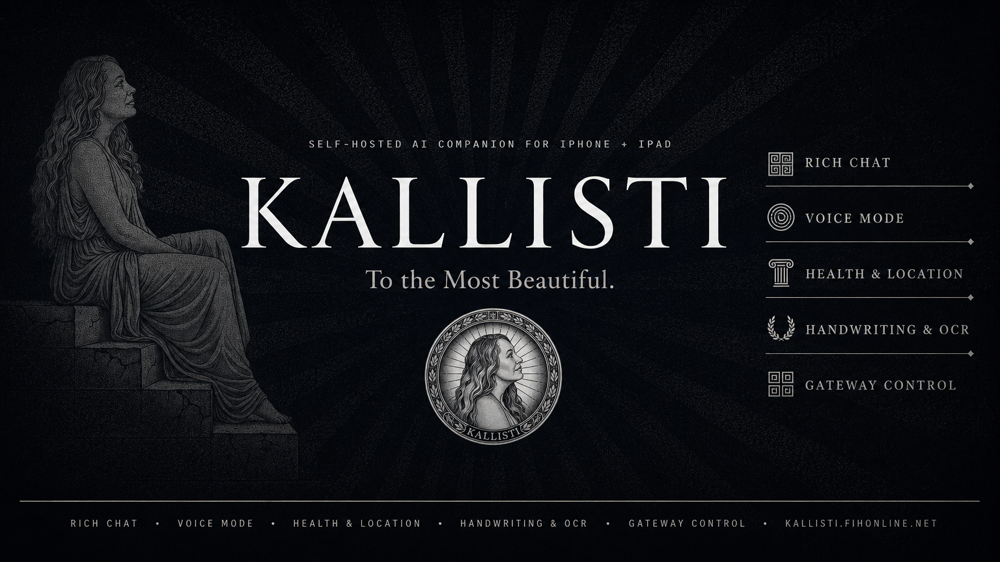

# Kallisti for iOS

<p align="center">
  
</p>

<p align="center">
  
  
  
  
  
</p>

Kallisti is the iPhone and iPad frontend for **Kallisti-Eris**, the self-hosted
daemon that holds the brain, the tools and the memory. Eris is the backend; Kallisti
is the frontend. The app is the literal Kallisti 0.4.0 UI, and it talks to the daemon
over its own device API - there is no third-party relay, and nothing leaves your
infrastructure.

## The two halves

| Half | What it is |
|---|---|
| **Kallisti for iOS** (this branch) | The front. The literal Kallisti 0.4.0 UI - `AppRootView` -> the full `AdaptiveRootView` sidebar (Chat, Inbox, Talk, Notes, Settings), health and sensors - as native Swift 6 / SwiftUI. |
| **Kallisti-Eris** (`main`) | The back. A Rust daemon on your hardware: turns, tools, memory, MCP, approvals, sensors, inbox, notes, push and device pairing. |

## How it connects

`HeraldClientProtocol` is implemented by `ErisHeraldClient`, so the 0.4.0 screens run
over Eris unchanged. A fresh install pairs through the 0.4.0 onboarding:
`ErisPairingService` posts the daemon address + pairing code to `/v1/pair`, the pair
lands in the keychain, and the client restores it into chat.

**Backed over Eris:** pairing, chat + SSE streaming, conversations, session
create/list/search, Inbox, Senses (health/location), Settings.

**Still typed-stubbed** pending their device routes: session delete/archive/pin/rename,
title generation, job status, cancel/interrupt, voice transcript, note sync.
Attachments are text-only. Notes works local-first on device. Talk is in development.

## Status

Private beta. TestFlight **build 89** is the current iOS 1.4.1 build - the 0.4.0 UI on
Eris. TestFlight invites are distributed to beta testers.

## Features (0.4.0 UI)

- **Rich chat** - streaming, markdown, syntax-highlighted code, reasoning beside the answer
- **Health and sensors** - HealthKit, CoreLocation, CoreMotion into Eris `sensors.db`
- **Inbox** - Eris inbox items and actions
- **Notes** - local-first on device
- **Camera and photos**, **handwriting and OCR** (iPad), **widgets and Live Activities**, **push notifications**
- **Device pairing with opaque tokens** - the code is never persisted

## Requirements

- iOS 18 or newer
- A running **Kallisti-Eris** daemon (see the `main` branch)
- Xcode 16 or newer and an Apple Developer account only if you build from source

## Quick start

### TestFlight

Install Kallisti from TestFlight, open it, and enter your Eris daemon address plus a
minted pairing code at the onboarding pairing step. No Apple Developer account needed.

### Build from source

```bash
git clone https://github.com/fireishott/Kallisti.git
cd Kallisti
open Herald.xcodeproj
```

Select the `Kallisti` scheme, choose your Apple Developer team, and build to a
simulator or registered device.

## Security and privacy

- Credentials are stored in the iOS Keychain.
- Pairing codes are single-use and never persisted.
- Sensor synchronization is optional and self-hosted.

See [SECURITY.md](SECURITY.md).

## Release history

TestFlight for private beta testers; GitHub releases carry notes. Full history in
[CHANGELOG.md](CHANGELOG.md).

## License

MIT. See [LICENSE](LICENSE).

## Development team

- **Curtis Freeman** ([@fireishott](https://github.com/fireishott)) - Creator and lead developer.
- **Mark Davis** ([@doc-holliday-1](https://github.com/doc-holliday-1)) - iPhone and iPad development.
